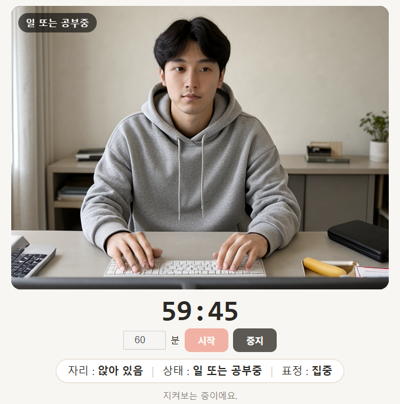

# focus-coach — 카메라와 Gemma4 AI를 연동해 보자 (Python · Java)

웹캠으로 나를 찍어 **내 PC 의 FlameBox 에서 돌아가는 Gemma 4 E4B**(사진을 이해하는 LLM)에게 보여 주고,
지금 내가 어떤 상태인지 화면에 보여 주는 앱입니다.

```
자리 : 앉아 있음  |  상태 : 일 또는 공부중  |  표정 : 집중
```

A webcam app that sends frames to a vision LLM Cortex (Gemma 4 E4B) on your own FlameBox and shows your current state
(seat · working / resting / sleeping · expression). Python (standard library only) or Java 21+ (no libraries, no Tomcat).
Blog post: https://flameai.im/blog/focus-coach



## 무엇을 하나

| 구분 | 내용 |
|---|---|
| 캠 | 화면 가운데에 내 모습. 0.5초 간격으로 4장을 찍어 한 묶음으로 AI 에게 보내고, 답이 오면 다시 찍습니다 |
| 상태 | **자리**(앉아 있음 / 자리 비움) · **상태**(일 또는 공부중 / 쉬는 중 / 자는 중) · **표정**(보통·웃음·집중·우울·피곤) |
| 타이머 | 시간(기본 60분)을 정하고 **시작** → 줄어드는 타이머, **중지**. 시간이 다 되면 멈춥니다 |
| 왼쪽 패널 | 마지막으로 AI 에게 보낸 요청(사진 4장·프롬프트)과 받은 응답(JSON·토큰·시간). 제목 옆 뱃지 **IDLE / 촬영 중 / 요청 중** |
| 오른쪽 패널 | 요청·응답 기록. 누르면 팝업으로 자세히(보낸 사진, 요청 본문, 응답 원문, 토큰·시간) |
| 패널 숨기기 | 오른쪽 위 **요청·응답 숨기기** · **기록 숨기기** |

## 어떻게 판단하나

```
브라우저 (캠·타이머)  ─ 사진 4장 (384×288 JPEG) ─▶  focus_coach.py / FocusCoach.java  ─▶  내 FlameBox · Gemma 4 E4B
                                                                │                        ◀─ {"person", "eyes", "head", "looking_at", "expression"}
                                                                └─ 상태 정하기 ─▶ 브라우저 (자리 · 상태 · 표정)
```

- **AI 에게는 보이는 것만 묻습니다.** 사람이 있는지, 눈, 고개, 어디를 보는지, 표정을 JSON 으로 답하게 하고,
  "일 또는 공부중 / 쉬는 중 / 자는 중" 은 프로그램이 정합니다.

  | 조건 | 상태 |
  |---|---|
  | `person: false` | 자리 비움 |
  | `eyes: closed`, 또는 `head: on_desk` 이면서 눈을 뜨지 않음 | 자는 중 |
  | `looking_at: phone` 또는 `away` | 쉬는 중 |
  | 그 밖 | 일 또는 공부중 |

- **JSON 은 프롬프트로 지시합니다.** FlameAI 에는 응답 형식을 강제하는 옵션이 없어서, system 프롬프트에 받을 형식을 적고
  받은 쪽에서 첫 `{ … }` 만 꺼내 읽습니다. `temperature: 0`(`apply_sampling: true` 와 함께)이면 형식이 잘 지켜집니다.
- **매번 새로 묻습니다.** 판단마다 `cortex_reset: true` 로 보내서 앞의 사진·답이 쌓이지 않게 합니다. 쌓이면 답이 점점 길어지고 느려집니다.
- 사진은 내 Cortex 에 올렸다가 **판단 직후 지웁니다.** 디스크에 저장하지 않습니다.

## 1. 준비

1. **FlameBox 설치·계정 연결** — [Windows 편](https://flameai.im/blog/flamebox-install-windows) · [Linux 편](https://flameai.im/blog/flamebox-install-linux)
2. **Gemma 4 E4B Cortex 만들기** — 콘솔 Cortex 만들기에서 Gemma 4 E4B 로 만듭니다. 사진을 받는 Cortex 여야 합니다.
3. **Python 3.9 이상** (설치할 라이브러리 없음) — 또는 **JDK 21 이상** (Java 판)
4. **웹캠** — 노트북 내장 캠이면 됩니다.

## 2. 받기와 설정

```bash
git clone https://github.com/FlameAI-Playground/apps
cd apps/focus-coach
```

필요한 값 2개:
- **API URL** — 마이페이지 › **Cortex** 목록에서 Gemma 4 E4B 카드의 주소 옆 **복사**
- **Secret Key** — 마이페이지 › **설정** › My API

### 방법 1 — 환경변수 (권장, 파일에 키가 남지 않음)

**Windows (PowerShell)** — 지금 연 창에서만 유효합니다.
```powershell
$env:FLAMEAI_API_URL    = "https://api-3.flameai.im/Nx7bQ2mZ/cortex/7f3c9a12-4e6b-4d8f-9a21-6b5e8c1f2d3a/messages"
$env:FLAMEAI_SECRET_KEY = "0123456789ABCDEFGH"
```

**Windows (명령 프롬프트)**
```bat
set FLAMEAI_API_URL=https://api-3.flameai.im/Nx7bQ2mZ/cortex/7f3c9a12-4e6b-4d8f-9a21-6b5e8c1f2d3a/messages
set FLAMEAI_SECRET_KEY=0123456789ABCDEFGH
```

**macOS · Linux**
```bash
export FLAMEAI_API_URL="https://api-3.flameai.im/Nx7bQ2mZ/cortex/7f3c9a12-4e6b-4d8f-9a21-6b5e8c1f2d3a/messages"
export FLAMEAI_SECRET_KEY="0123456789ABCDEFGH"
```

위 주소와 `0123456789ABCDEFGH` 자리에 내 API URL 과 Secret Key 를 넣으세요. 계속 쓰려면 Windows 는 `setx FLAMEAI_API_URL "…"`·`setx FLAMEAI_SECRET_KEY "…"` 후 **새 터미널**을 열고,
macOS·Linux 는 `export` 두 줄을 `~/.zshrc`·`~/.bashrc` 에 넣습니다(공용 PC 에서는 하지 마세요).

### 방법 2 — 소스 위쪽 상수

```python
API_URL = "https://api-xxxx.flameai.im/AbCd1234/cortex/YOUR_CORTEX_ID/messages"  # Cortex 목록의 API URL (Gemma 4 E4B)
SECRET_KEY = "YOUR_SECRET_KEY"                                                     # 설정 › My API › Secret key
```

상수가 자리 표시 값 그대로면 환경변수를 읽습니다.

> **실제 Secret Key 를 넣은 파일은 공유하거나 저장소에 올리지 마세요.** 다른 사람에게 줄 때는 키를 지운 원본을 주고, 각자 자기 키를 넣게 합니다.

## 3. 실행

```bash
python python/focus_coach.py          # Python
java java/FocusCoach.java             # Java 21+ (JDK 내장 웹서버, 톰캣 필요 없음)
```

브라우저에서 **http://localhost:8080** 을 열고 카메라를 허용 → 시간을 정하고 **시작**.

- 주소 뒤에 `?minutes=25&start=1` 을 붙이면 25분으로 바로 시작합니다.
- 서버는 이 PC(`127.0.0.1`)에서만 열립니다. 끝낼 때는 콘솔에서 `Ctrl+C`.

콘솔에는 판단 결과가 한 줄씩 찍힙니다.

```
14:18:03 working  {'person': True, 'eyes': 'open', 'head': 'upright', 'looking_at': 'screen', 'expression': 'neutral'} (1.1s)
14:18:07 resting  {'person': True, 'eyes': 'open', 'head': 'upright', 'looking_at': 'phone', 'expression': 'neutral'} (1.1s)
14:18:19 sleeping {'person': True, 'eyes': 'closed', 'head': 'on_desk', 'looking_at': 'unknown', 'expression': 'tired'} (1.2s)
14:18:31 away     {'person': False, 'eyes': 'unknown', 'head': 'upright', 'looking_at': 'unknown', 'expression': 'neutral'} (1.1s)
14:18:40 working  {'person': True, 'eyes': 'open', 'head': 'upright', 'looking_at': 'screen', 'expression': 'neutral'} (1.2s)
```

(AI로 만든 가상 인물 영상을 브라우저의 가짜 카메라로 넣어 시험한 실제 출력 중 상태별로 몇 줄을 골랐습니다. 괄호 안은 AI 응답 시간 —
시험 장비(RTX 4090 Laptop)에서 1.1~1.2초, 사진 4장(384×288)은 입력 522 토큰·출력 33~34 토큰, 4장을 찍는 1.5초를 더해 약 3초마다 한 번 판단했습니다.
처음 한 번은 모델을 올리느라 7.8초가 걸렸습니다.)


## 4. 바꿔 보기

| 어디 | 무엇 |
|---|---|
| `SYSTEM_PROMPT` | AI 에게 묻는 항목. 항목을 늘리면 `state_of()`(Java `stateOf()`)와 화면도 함께 |
| `state_of()` | 보이는 것 → 상태 규칙 |
| 페이지 스크립트의 `SIZE` | AI 에게 보내는 사진 크기(기본 384×288). 작을수록 토큰이 줄고 빠르지만 눈·표정을 놓칠 수 있음 |
| 페이지 스크립트의 `STATES`, `FACES` | 화면에 보이는 한글 이름 |

응용: 상태가 오래 이어지면 알림 띄우기, 하루 동안의 상태를 파일로 남겨 집중 시간 그래프 그리기, 자세(거북목) 측정 더하기.

## 5. 한계와 주의

- **판단은 틀릴 수 있습니다.** 작은 모델(E4B)이 사진 몇 장으로 보는 것이라, 표정은 특히 흔들립니다(찡그린 얼굴을 "우울"로 보는 등). 참고용으로 쓰세요.
- **본인만 쓰세요.** 다른 사람(직원·학생 등)을 동의 없이 찍거나 감정을 판정하는 데 쓰면 안 됩니다. 나라에 따라 법으로 금지된 용도도 있습니다.
- **사진이 어디로 가나** — 브라우저 → 이 PC 의 프로그램 → FlameAI 를 거쳐 → 내 FlameBox. 판단 직후 내 Cortex 에서 지웁니다.
- **실행 중에는 이 앱이 E4B Cortex 를 씁니다.** 다른 프로그램이 같은 Cortex 를 쓰면 `cortex_occupied` 가 납니다.
- **메모리** — 같은 PC 에 이미지 생성 모델 같은 큰 Cortex 가 함께 올라가 있으면 실패할 수 있습니다.

## 6. 오류

| 메시지 | 할 일 |
|---|---|
| API_URL, SECRET_KEY 를 내 값으로 바꾸거나 환경변수…를 설정하세요 | 같은 터미널 창에서 환경변수를 넣고 실행했는지 확인 |
| API URL 또는 Secret Key 가 틀렸습니다 | Cortex 목록·설정에서 다시 복사 |
| FlameBox 가 꺼져 있습니다 | FlameBox PC 를 켜고 FlameBox 실행 |
| 요청이 거절되었습니다 … 이미지를 받는 Cortex | 사진을 받는 Cortex(Gemma 4 E4B)의 API URL 인지 확인 |
| 카메라를 열 수 없습니다 | 브라우저 주소창의 카메라 권한 허용, 다른 앱(화상회의 등)이 캠을 쓰는지 확인 |
