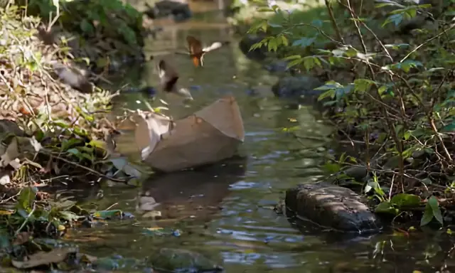

# video-generator — API로 AI 동영상 만들기 (Java · LTX 2.5)

> **⚠ 동영상 모델은 VRAM(그래픽 메모리)과 시간을 많이 씁니다.** 같은 PC 에 다른 큰 모델(이미지·대화 Cortex)이 올라가 있으면 실패할 수 있습니다.
> 처음에는 짧게(25프레임 ≈ 1초) 만들어 보고 늘려 가세요.

문장을 넣으면 내 PC 의 FlameBox 에서 돌아가는 동영상 모델(LTX 2.5 Cortex)이 **소리까지 들어간 영상(webm)** 을 만들어 저장하는 콘솔 프로그램입니다.
**Java 21 이상**, 라이브러리 없이 파일 하나(`java/VideoGenerator.java`). 같은 기능의 Python 판은 `python/video_generator.py`.

A text-to-video console app (video + sound, webm) using a video Cortex such as LTX 2.5 on your own FlameBox. Java 21+, single file, no libraries.
Blog post: https://flameai.im/blog/video-generator

```
> java VideoGenerator.java --size 640x384 --frames 121 --fps 24 --seed 7 -o boat5s.webm "A paper boat floating down a small stream in a sunny forest, gentle water ripples, leaves drifting, birds chirping, cinematic"
640x384, 121프레임, 24fps (약 5.0초 영상)
만드는 중 [####################] 8/8  영상으로 변환하는 중...
저장: boat5s.webm   (seed 7, 소리 있음, 181초)
```



결과 영상(소리 포함): [media/boat.webm](media/boat.webm) — 위 움직이는 그림은 그 영상을 12fps 로 줄인 것(소리 없음)입니다.
(실제 실행 결과. 시험 장비(RTX 4090 Laptop)에서 25프레임(약 1초) 149초(모델 로드 8초 포함), 121프레임(약 5초) 181초.)

## 1. 준비

1. **FlameBox 설치·계정 연결** — [Windows 편](https://flameai.im/blog/flamebox-install-windows) · [Linux 편](https://flameai.im/blog/flamebox-install-linux)
2. **동영상 Cortex 만들기** — 콘솔 Cortex 만들기에서 LTX 2.5 모델로 만듭니다. VRAM 이 넉넉한 FlameBox 를 고르세요.
3. **JDK 21 이상** (Python 판은 Python 3.9 이상)

## 2. 설정 — 값 2개

- **API URL** — 마이페이지 › **Cortex** 목록에서 동영상 Cortex 카드의 주소 옆 **복사** (`…/videoGenerate` 로 끝남)
- **Secret Key** — 마이페이지 › **설정** › My API

**Windows (PowerShell)**
```powershell
$env:FLAMEAI_API_URL    = "https://api-3.flameai.im/Nx7bQ2mZ/cortex/7f3c9a12-4e6b-4d8f-9a21-6b5e8c1f2d3a/videoGenerate"
$env:FLAMEAI_SECRET_KEY = "0123456789ABCDEFGH"
```

**macOS · Linux**
```bash
export FLAMEAI_API_URL="https://api-3.flameai.im/Nx7bQ2mZ/cortex/7f3c9a12-4e6b-4d8f-9a21-6b5e8c1f2d3a/videoGenerate"
export FLAMEAI_SECRET_KEY="0123456789ABCDEFGH"
```

또는 소스 위쪽 상수 2개(`API_URL`, `SECRET_KEY`)를 바꿉니다. 상수가 자리 표시 값이면 환경변수를 읽습니다.

> **실제 Secret Key 를 넣은 파일은 공유하거나 저장소에 올리지 마세요.**

## 3. 실행

| 하고 싶은 것 | 명령 |
|---|---|
| 만들기 (기본 640×384, 121프레임 ≈ 5초) | `java VideoGenerator.java "영상 설명 (영어 권장)"` |
| 짧게 먼저 (≈ 1초) | `java VideoGenerator.java --frames 25 "…"` |
| 크기 (32 의 배수) | `java VideoGenerator.java --size 768x512 "…"` |
| 같은 영상 다시 | `java VideoGenerator.java --seed 7 "…"` |
| 저장 이름 | `java VideoGenerator.java -o boat.webm "…"` |

Python 판: `python video_generator.py` 에 같은 옵션.

## 4. 코드 구성

| 부분 | 하는 일 |
|---|---|
| `API_URL` → `CORTEX` | 주소에서 `/videoGenerate` 를 뗀 `…/cortex/{id}` — 결과 파일도 이 주소 아래 |
| `generate()` | `videoGenerate` 를 `stream: true` 로 불러 진행률(8단계)을 보여 주고, 마지막 단계 뒤 영상 변환이 끝나면 결과(`files/gen-….webm`)를 받음 |
| `download()` / `delete()` | webm 을 내려받고 FlameBox 에 남은 파일을 지움 |

## 5. 알아 둘 점

- **규칙** — LTX 는 가로·세로 32 의 배수, 프레임 수 **8n+1**(25, 49, 121 …). 영상 길이 ≈ 프레임 ÷ fps.
- **시간** — 짧은 영상도 2~3분 걸립니다. 진행률은 생성 단계 기준이라, 마지막 단계 뒤 영상으로 변환하는 동안은 진행률 없이 기다립니다.
- **영어 프롬프트** — 공개 문서는 영어를 권장합니다. 움직임·소리(예: birds chirping)까지 적으면 그대로 반영되기도 합니다.
- **AI 영상의 한계** — 물체 모양이 프레임마다 조금씩 바뀌는 등(예제의 종이배) 어색한 부분이 생길 수 있습니다. seed 를 바꿔 여러 번 만들어 보세요.
- **메모리** — 크기·프레임을 늘리면 메모리를 더 씁니다. `internal_error` 가 나면 줄이거나 같은 PC 의 다른 Cortex 를 내리고 다시 하세요.

## 6. 오류

| 메시지 | 할 일 |
|---|---|
| `bearer_invalid` | API URL·Secret Key 를 다시 복사 |
| `cortexbox_offline` | FlameBox PC 를 켜고 FlameBox 실행 |
| `unsupported_cortex_type` | 동영상 Cortex 의 API URL 인지 확인 |
| `bad_request` | 크기 32 의 배수, 프레임 8n+1 인지 확인 |
| `cortex_init_fail` / `internal_error` | VRAM 부족일 수 있음 — 크기·프레임을 줄이거나 다른 Cortex 를 내리고 다시 |
